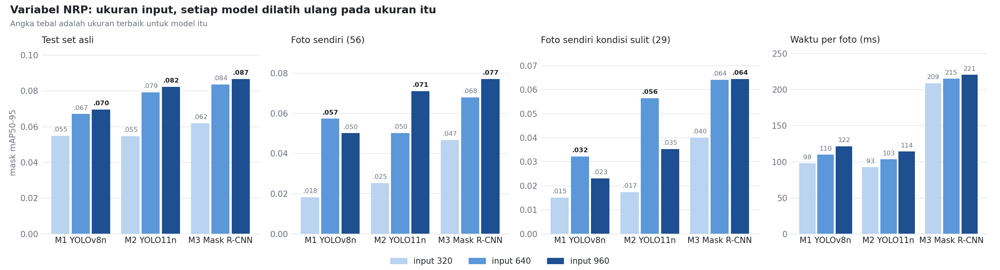
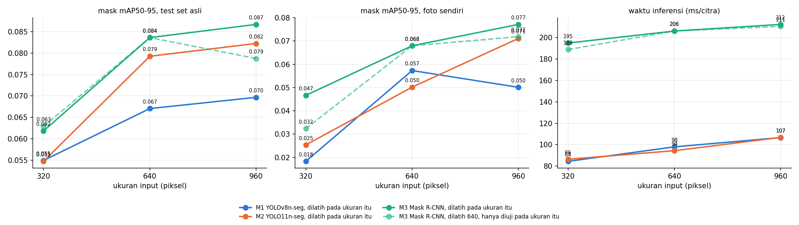
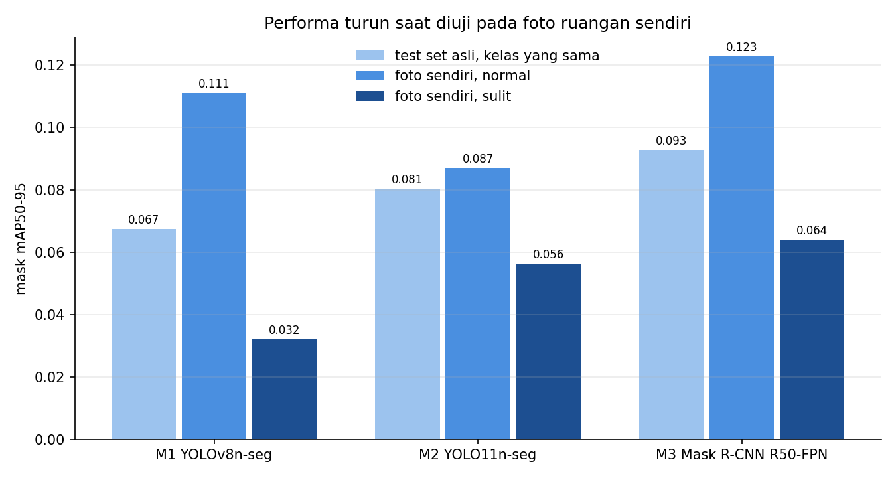
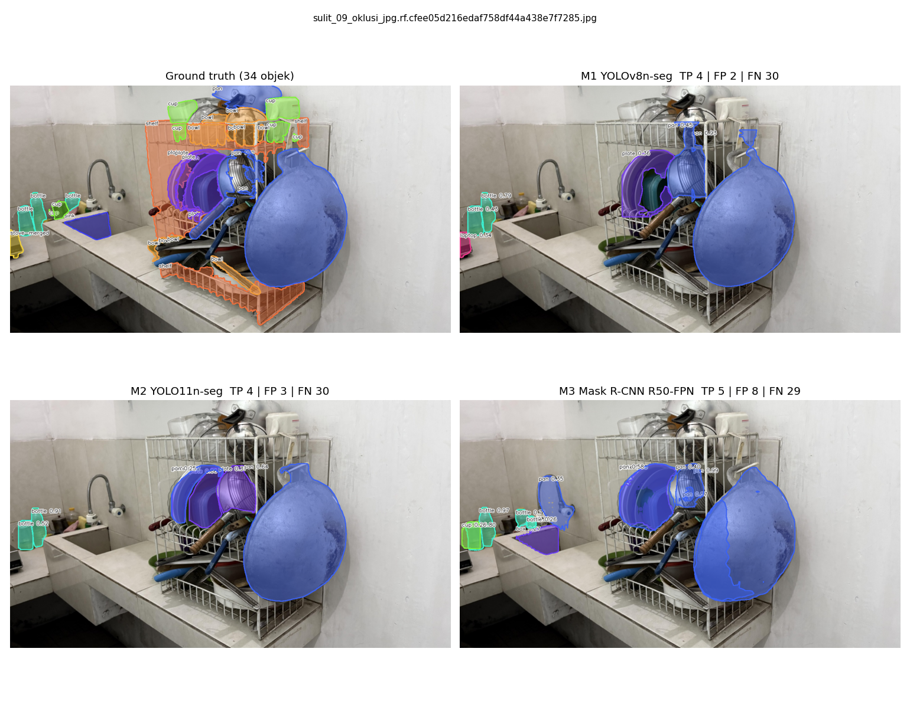
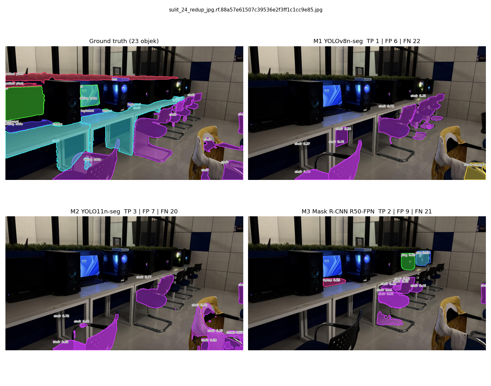
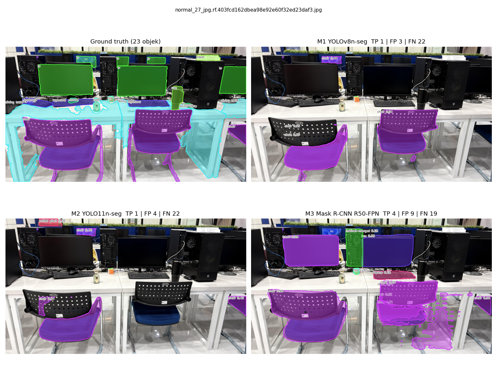
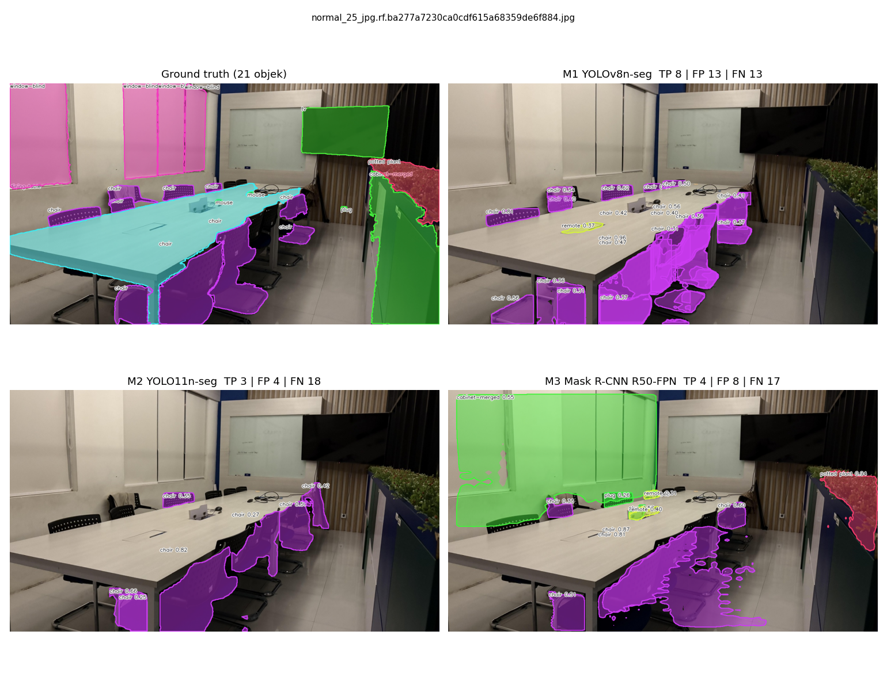

# Hasil dan Analisis Segmentasi Instance Indoor

Semua angka berasal dari commit Kaggle versi 4 (`logs/kaggle_v4_log.txt`, folder `hasil_kaggle_v4/`) dengan anotasi foto sendiri versi 3 (555 objek). Metrik utama adalah mask mAP50-95 versi COCO yang dihitung dengan evaluator yang sama untuk ketiga model, dan foto sendiri diperkecil ke sisi terpanjang 1280 sebelum dinilai. Hasil versi 3 dengan anotasi lama (583 objek) tetap disimpan di `hasil_kaggle_v3/` sebagai pembanding.

## 1. Perbandingan tiga model

| Model | Valid asli | Test asli | Test asli, kelas foto sendiri | Foto sendiri | Sendiri normal | Sendiri sulit | Inferensi (ms/citra) | Parameter | GPU latih |
|---|---|---|---|---|---|---|---|---|---|
| M1 YOLOv8n-seg | 0,169 | 0,067 | 0,067 | 0,057 | 0,111 | 0,032 | 98 | 3,4 juta | 0,39 jam |
| M2 YOLO11n-seg | **0,192** | 0,079 | 0,081 | 0,050 | 0,087 | 0,056 | 94 | 2,9 juta | 0,50 jam |
| M3 Mask R-CNN R50-FPN | 0,179 | **0,084** | 0,093 | **0,068** | **0,123** | **0,064** | 206 | 44,3 juta | 1,01 jam |

Mask R-CNN unggul di test asli maupun foto sendiri, tetapi dua kali lebih lambat dan 13 kali lebih besar daripada YOLO nano. Nilai di split valid (0,17–0,19) dekat dengan mAP validasi saat training (0,20 dan 0,21 untuk YOLO dari validator Ultralytics, 0,17 untuk Mask R-CNN), sehingga evaluator konsisten. Angka test yang tiga kali lebih rendah berasal dari split test yang memang lebih sulit, bukan dari cara penilaian. Waktu inferensi di tabel diukur pada test asli dengan GPU T4.

Nilai absolut ketiga model rendah karena dataset latih hanya berisi 397 citra untuk 73 kelas dan banyak kelas hampir tidak punya contoh. Di split train, `teddy bear` hanya muncul 6 kali, `keyboard` 7 kali, `mouse` 8 kali, dan `tv` 38 kali, sehingga AP keempat kelas itu 0 (atau hampir 0) bahkan di test asli. Meja juga punya masalah definisi label, karena data latih menandai sebagian besar meja sebagai `table-merged` (711 objek) dan hanya 117 sebagai `dining table`, sedangkan meja di foto sendiri dianotasi sebagai `dining table`. Akibatnya AP `dining table` 0 untuk ketiga model di foto sendiri.

## 2. Variabel NRP: ukuran input

NRP berakhiran 1, sehingga variabelnya adalah ukuran input 320, 640, dan 960. Ketiga model dilatih ulang pada setiap ukuran dan diuji pada ukuran yang sama. Mask R-CNN yang dilatih pada 640 juga diuji pada 320 dan 960 tanpa training ulang, untuk melihat apakah mengganti ukuran saat inferensi saja sudah cukup.

| Model | Ukuran | Test asli | Foto sendiri | Sendiri sulit | AP kecil (foto sendiri) | Inferensi foto sendiri (ms) | GPU latih | Epoch |
|---|---|---|---|---|---|---|---|---|
| M1 YOLOv8n-seg | 320 | 0,055 | 0,018 | 0,015 | 0,000 | 98 | 0,46 jam | 280 |
| | 640 | 0,067 | **0,057** | **0,032** | 0,006 | 110 | 0,39 jam | 154 |
| | 960 | **0,070** | 0,050 | 0,023 | 0,000 | 122 | 0,84 jam | 196 |
| M2 YOLO11n-seg | 320 | 0,055 | 0,025 | 0,017 | 0,000 | 93 | 0,41 jam | 231 |
| | 640 | 0,079 | 0,050 | **0,056** | 0,000 | 103 | 0,50 jam | 192 |
| | 960 | **0,082** | **0,071** | 0,035 | 0,021 | 114 | 1,00 jam | 229 |
| M3 Mask R-CNN | 320 | 0,062 | 0,047 | 0,040 | 0,000 | 209 | 1,01 jam | 53 |
| | 640 | 0,084 | 0,068 | **0,064** | 0,029 | 215 | 1,01 jam | 45 |
| | 960 | **0,087** | **0,077** | **0,064** | 0,000 | 221 | 1,01 jam | 27 |
| M3 dilatih 640, hanya diuji | 320 | 0,063 | 0,032 | 0,027 | 0,000 | 202 | | |
| | 960 | 0,079 | 0,072 | 0,056 | 0,000 | 225 | | |

**320 paling buruk untuk ketiga model di semua set.** Penurunannya paling tajam di foto sendiri, misalnya YOLOv8 turun dari 0,057 ke 0,018. Foto iPhone 16 berukuran 5712×3213, sehingga saat diperkecil ke 320 objek seperti mouse, gelas, dan kursi di ujung ruangan tinggal beberapa piksel dan AP objek kecil ketiga model menjadi 0.

**Di test asli, 960 selalu terbaik, tetapi selisihnya dari 640 kecil** (+0,003 untuk ketiga model). Citra dataset latih sudah berukuran 640, sehingga memperbesarnya ke 960 tidak menambah detail baru.

**Di foto sendiri, 960 terbaik untuk YOLO11 dan Mask R-CNN.** YOLO11 naik 42% dari 640 (0,050 → 0,071) dan Mask R-CNN naik 13% (0,068 → 0,077), karena foto sendiri memang punya detail lebih banyak daripada 640 piksel. YOLOv8 menjadi pengecualian karena justru turun di 960 (0,057 → 0,050). Selisih 0,007 pada 56 foto termasuk kecil, sehingga hasil ini dibaca sebagai tanda bahwa keuntungan 960 tidak otomatis berlaku untuk setiap model.

**Di foto sulit, 640 terbaik atau sama baiknya dengan 960 untuk ketiga model.** Foto redup memakai ISO sampai 8000 dan foto burem kehilangan tepi, sehingga resolusi yang lebih besar ikut memperjelas noise dan blur, bukan objeknya. Foto sulit hanya 29, sehingga pola ini dibaca sebagai kecenderungan.

**Melatih ulang pada ukuran target lebih baik daripada hanya mengganti ukuran saat inferensi.** Mask R-CNN yang dilatih pada 320 mendapat 0,047 di foto sendiri, sedangkan model 640 yang hanya diuji pada 320 mendapat 0,032. Pada 960 selisihnya 0,077 dibanding 0,072 di foto sendiri dan 0,087 dibanding 0,079 di test asli. Model yang dilatih pada satu ukuran belajar ukuran objek di feature map pada skala itu, sehingga mengganti ukuran saat inferensi menggeser objek ke skala yang belum pernah dilihat.

**Biayanya ada di waktu.** Inferensi naik sekitar 10% setiap naik satu ukuran, sedangkan waktu training YOLO di 960 hampir dua kali lipat. Mask R-CNN dibatasi 1 jam GPU di setiap ukuran, sehingga di 960 hanya sempat 27 epoch dibanding 53 epoch di 320. Mask R-CNN 960 tetap terbaik walaupun epoch-nya paling sedikit, sehingga nilainya kemungkinan masih bisa naik dengan waktu training lebih lama.

**Kesimpulan variabel NRP.** Untuk foto HP beresolusi tinggi dalam kondisi normal, 960 memberi hasil terbaik pada YOLO11 dan Mask R-CNN dengan tambahan waktu sekitar 10%. Ukuran 640 adalah pilihan paling seimbang, karena paling tahan di foto sulit dan paling baik untuk YOLOv8, sedangkan 320 tidak disarankan untuk model mana pun.

## 3. Domain shift

| Model | Test asli (kelas sama) | Foto sendiri | Penurunan relatif | Recall kos | Recall lab |
|---|---|---|---|---|---|
| M1 YOLOv8n-seg | 0,067 | 0,057 | −15% | 0,102 | 0,082 |
| M2 YOLO11n-seg | 0,081 | 0,050 | −38% | 0,083 | 0,088 |
| M3 Mask R-CNN | 0,093 | 0,068 | −27% | 0,150 | 0,098 |

Ketiga model turun di foto sendiri secara keseluruhan, tetapi penurunannya tidak merata. Foto sendiri kondisi normal justru lebih tinggi daripada test asli (M3 0,123 vs 0,093, M1 0,111 vs 0,067), karena foto kos yang terang berisi objek besar dan jelas seperti kasur, bantal, dan botol. Seluruh penurunan datang dari foto sulit (0,032–0,064) dan dari foto laboratorium. Recall di lab lebih rendah daripada di kos untuk YOLOv8 dan Mask R-CNN, sedangkan YOLO11 sama rendahnya di kedua tempat. Lab berisi monitor mati, deretan kursi beroda, dan meja panjang, sedangkan data latih didominasi ruangan rumah.

Penurunan per kelas memperlihatkan polanya. `bed` turun dari 0,07–0,13 menjadi 0,01–0,04 karena kasur kos tanpa rangka dan bersprei motif berbeda dari kasur di data latih, sedangkan `pillow` (0,03–0,04 menjadi 0,14–0,23) dan `bottle` (0,11–0,21 menjadi 0,17–0,33) justru naik karena di foto sendiri keduanya besar, terang, dan tidak tertutup. Recall per kondisi (dihitung dari `per_citra_sendiri_*.csv`) menunjukkan foto redup paling rendah (0,03–0,09), lalu burem (0,04–0,08) dan backlight (0,05–0,10), sedangkan foto sudut ekstrem justru tertinggi (0,10–0,32) karena keempat foto itu berisi objek besar seperti lemari dan kasur.

## 4. Pengecekan hipotesis

| No | Hipotesis (logbook 25-11-2026) | Hasil | Status |
|---|---|---|---|
| H1 | M3 unggul di foto sendiri, terutama objek kecil | M3 0,068 vs 0,057 dan 0,050. AP kecil M3 0,029 vs YOLO 0,006 dan 0,000. Oracle mask objek kecil 0,993 untuk grid 28×28 Mask R-CNN vs 0,789 untuk prototype YOLO | Didukung |
| H2 | YOLO menyamai M3 untuk objek besar karena prototype tidak bergantung ukuran box | Oracle objek besar YOLO 0,983 vs Mask R-CNN 0,977, tetapi AP besar M3 tetap tertinggi (0,101 vs 0,085 dan 0,062) | Tidak didukung. Batas resolusi mask untuk objek besar hampir sama, sehingga selisih AP datang dari deteksi dan klasifikasi |
| H3 | Turun > 30%, terbesar di lab | Turun 15%, 38%, dan 27%. Recall lab lebih rendah daripada kos untuk M1 dan M3 | Sebagian. Penurunan > 30% hanya pada M2, dan lab paling sulit untuk dua dari tiga model |
| H4 | Redup paling merusak | Recall redup 0,03–0,09 dan backlight 0,05–0,10, keduanya di bawah normal (0,09–0,15). Kombinasi redup-burem dan burem-sudut bernilai 0 | Didukung, tetapi backlight hampir sama merusaknya |
| H5 | Gamma/CLAHE menaikkan TP di foto redup | Total TP 5 foto kegagalan: CLAHE 16/15/16 dan gamma 12/15/13 vs asli 15/13/18 (M1/M2/M3) | Tidak didukung. Pencerahan tidak konsisten membantu, sehingga kegagalan di foto redup lab bukan terutama karena gelap |
| H6 | Salah kelas teddy bear/toy, cabinet/shelf, meja | Salah kelas yang paling sering justru monitor mati menjadi `chair`/`box` dan tirai gulung menjadi `cabinet-merged`. AP `teddy bear` tetap 0 setelah anotasi boneka dibetulkan, karena kelas itu hanya punya 6 contoh di data latih | Sebagian |

## 5. Lima studi kasus kegagalan

Kelima foto dipilih otomatis dari `kandidat_kegagalan.csv` sebagai foto dengan jumlah FN + FP terbesar dari ketiga model. TP dihitung pada ambang skor 0,25 dan IoU mask ≥ 0,5. Uji varian ada di `uji_varian_kegagalan.csv` dan IoU oracle ada di `oracle_resolusi_mask.csv`.

### Kasus 1 · `sulit_09_oklusi`, rak piring penuh

Dari 34 objek, ketiga model hanya menemukan 4–5. Mangkok, gelas, dan piring yang bertumpuk di balik kawat rak hampir semuanya terlewat, sedangkan wajan besar di depan terdeteksi dengan baik. Mask R-CNN bahkan memecah wajan itu menjadi beberapa mask `pan`.

Mekanismenya oklusi berat. Setiap mangkok hanya terlihat sebagian dan terpotong garis kawat, sehingga satu objek tampak seperti beberapa potongan kecil. Pada YOLO, potongan tipis seperti sendok dan gagang wajan berada di bawah resolusi prototype, dan IoU oracle YOLO untuk objek di foto ini turun sampai 0,09, sedangkan grid 28×28 Mask R-CNN tetap di atas 0,94. Uji varian hampir tidak mengubah apa pun (TP M3 tetap 4–5 di semua varian), sehingga masalahnya bukan pencahayaan atau ukuran input, melainkan objek yang tertutup.

### Kasus 2 · `sulit_23_redup`, lab redup

Lima monitor, lima keyboard, dan meja panjang tidak terdeteksi sama sekali. Mask R-CNN memberi label `chair` pada monitor dan `laptop` pada monitor lain.

AP `tv`, `keyboard`, dan `dining table` sudah 0 (atau hampir 0) di test asli, sehingga kegagalan ini berasal dari kelas yang memang belum dipelajari, ditambah tampilan monitor mati yang hanya berupa persegi hitam. Pada model two-stage, RPN tetap mengusulkan box di monitor karena bentuknya jelas, lalu classifier memilih kelas yang paling sering ia lihat, yaitu `chair`. Uji pencerahan tidak menolong (TP M3 3 → 0 dengan gamma), sedangkan input 960 menaikkan TP M3 menjadi 4. Jadi masalah di foto ini adalah kelas dan skala, bukan gelapnya.

### Kasus 3 · `sulit_24_redup`, deretan kursi lab

Model menemukan kursi tetapi hampir semuanya dihitung salah. Deretan kursi beroda yang saling menutupi digabung menjadi satu mask besar, atau sebaliknya satu kursi hanya tertutup separuh, sehingga IoU-nya dengan kursi sebenarnya di bawah 0,5 dan tercatat sekaligus sebagai FP dan FN.

Mekanismenya pemisahan instance pada objek sejenis yang berdempetan. YOLO menyusun mask dari kombinasi prototype yang sama untuk semua instance, sehingga kursi yang bersentuhan mudah menyatu. Mask R-CNN membuat mask terpisah per box, tetapi box kursi yang tumpang tindih saling ditekan oleh NMS. IoU oracle di foto ini tinggi (rata-rata 0,98 untuk Mask R-CNN), jadi resolusi mask bukan penyebabnya. Varian input dan pencerahan juga tidak memperbaiki (TP M2 3 → 2–3).

### Kasus 4 · `normal_27`, lab terang

Foto ini terang dan tajam, tetapi M1 dan M2 hanya menemukan satu objek dari 23. Mask R-CNN menemukan 4 dan memberi label `chair`, `box`, dan `cabinet-merged` pada monitor serta PC.

Kasus ini menjadi pembanding penting bagi kasus 2, karena kondisinya normal tetapi kegagalannya sama. Artinya penyebab utama di lab adalah domain shift kelas dan tampilan (monitor mati, PC tower, meja lab putih yang tidak mirip meja makan di data latih), bukan pencahayaan. Mencerahkan foto tidak memberi perubahan berarti (TP M3 4 → 3–4).

### Kasus 5 · `normal_25`, ruang rapat

Kursi di sisi meja panjang digabung oleh Mask R-CNN menjadi satu mask besar (objek tergabung), tirai gulung dibaca sebagai `cabinet-merged`, dan meja panjang tidak terdeteksi. Di foto ini M1 justru paling baik (TP 8).

Kursi di ujung ruangan sangat kecil, dan IoU oracle YOLO untuk objek terkecil di foto ini turun sampai 0,49. Hasil uji varian mendukung dugaan objek terlalu kecil, karena memperbesar input Mask R-CNN ke 1280 menaikkan TP dari 4 menjadi 6. Gabungnya kursi menjadi satu mask terjadi karena satu box besar mencakup beberapa kursi, lalu grid 28×28 di dalam box itu tidak cukup rapat untuk memisahkan sandaran-sandaran kursi yang berjarak beberapa piksel.

## 6. Keterbatasan

Anotasi foto sendiri sudah diperiksa ulang pada 25-11-2026 (boneka dari `toy` ke `teddy bear`, potongan kaki kursi dan meja dihapus), tetapi perbedaan definisi meja antara `table-merged` di data latih dan `dining table` di foto sendiri belum diseragamkan. Setiap kondisi sulit hanya diwakili 1–12 foto, sehingga perbandingan antar kondisi lebih tepat dibaca sebagai kecenderungan daripada angka pasti. Mask R-CNN dibatasi 1 jam GPU per ukuran, sehingga run 960 berhenti lebih awal dalam hitungan epoch daripada run 320 dan 640.
