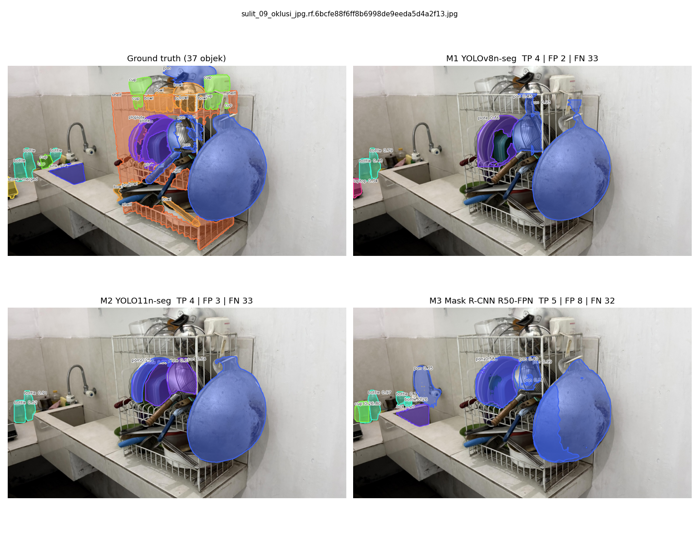
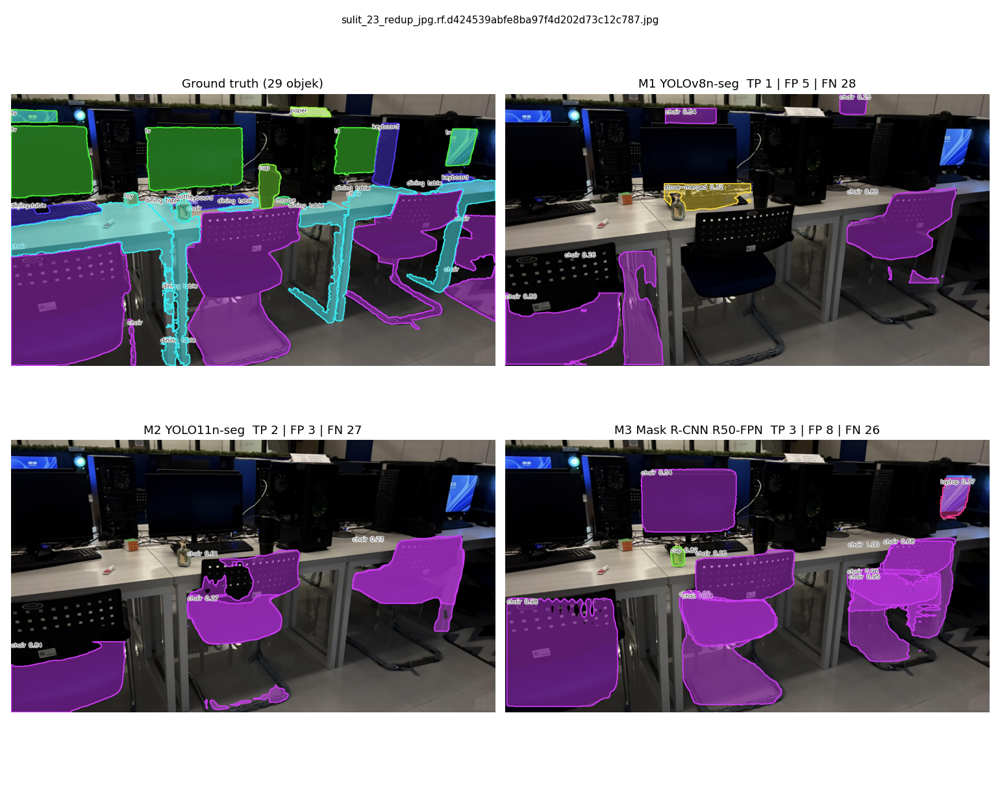
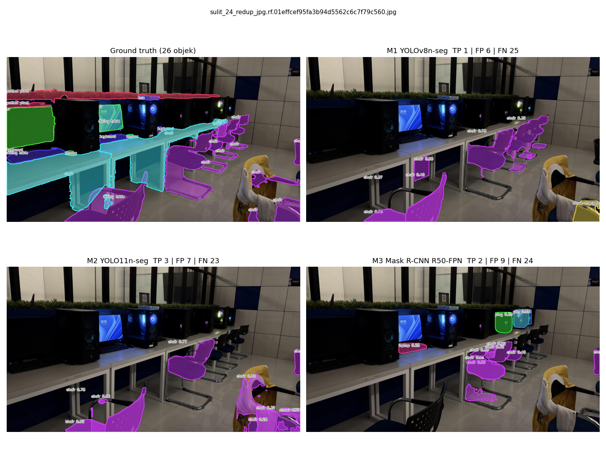
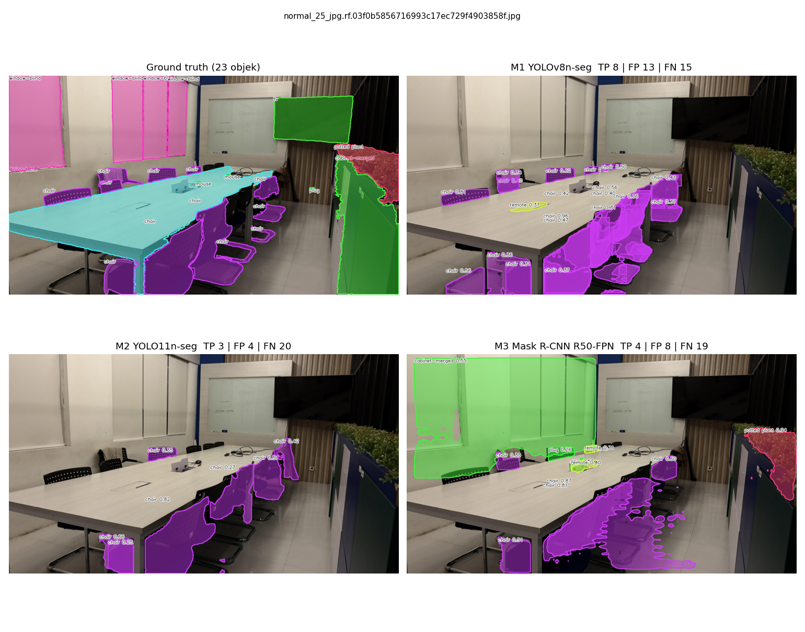

# Hasil dan Analisis Segmentasi Instance Indoor

Semua angka berasal dari commit Kaggle versi 3 (`logs/kaggle_v3_log.txt`, folder `hasil_kaggle_v3/`). Metrik utama adalah mask mAP50-95 versi COCO yang dihitung dengan evaluator yang sama untuk ketiga model, dan foto sendiri diperkecil ke sisi terpanjang 1280 sebelum dinilai.

## 1. Perbandingan tiga model

| Model | Valid asli | Test asli | Test asli, kelas foto sendiri | Foto sendiri | Sendiri normal | Sendiri sulit | Inferensi (ms/citra) | Parameter | GPU latih |
|---|---|---|---|---|---|---|---|---|---|
| M1 YOLOv8n-seg | 0,169 | 0,067 | 0,068 | 0,059 | 0,115 | 0,035 | 108 | 3,4 juta | 0,39 jam |
| M2 YOLO11n-seg | 0,192 | 0,079 | 0,081 | 0,052 | 0,089 | 0,061 | 102 | 2,9 juta | 0,50 jam |
| M3 Mask R-CNN R50-FPN | 0,179 | 0,084 | 0,093 | **0,071** | **0,126** | **0,062** | 210 | 44,3 juta | 1,01 jam |

Mask R-CNN unggul di test asli maupun foto sendiri, tetapi dua kali lebih lambat dan 13 kali lebih besar daripada YOLO nano. Nilai di split valid (0,17–0,19) dekat dengan mAP validasi saat training (0,20 dan 0,21 untuk YOLO dari validator Ultralytics, 0,17 untuk Mask R-CNN), sehingga evaluator konsisten. Angka test yang tiga kali lebih rendah berasal dari split test yang memang lebih sulit, bukan dari cara penilaian.

Nilai absolut ketiga model rendah karena dataset latih hanya berisi 397 citra untuk 73 kelas dan banyak kelas hampir tidak dipelajari sama sekali. AP `keyboard`, `mouse`, `refrigerator`, dan `dining table` bernilai 0 (atau hampir 0) bahkan di test set asli.

## 2. Variabel NRP: ukuran input

| Seri | Ukuran | Test asli | Foto sendiri | AP kecil (foto sendiri) |
|---|---|---|---|---|
| YOLO11n-seg dilatih pada ukuran itu | 320 | 0,055 | 0,026 | 0,000 |
| | 640 | 0,079 | 0,052 | 0,000 |
| | 960 | 0,082 | **0,072** | 0,019 |
| Mask R-CNN dilatih 640, diuji pada ukuran itu | 320 | 0,063 | 0,034 | 0,000 |
| | 640 | **0,084** | 0,071 | 0,028 |
| | 960 | 0,079 | **0,073** | 0,000 |

Input yang lebih besar menolong lebih banyak di foto sendiri daripada di test asli. Pada YOLO11, kenaikan dari 640 ke 960 hanya +0,003 di test asli tetapi +0,020 di foto sendiri, karena foto iPhone 16 berukuran 5712×3213 berisi banyak objek kecil dan jauh (mouse, kursi di ujung ruangan) yang tinggal beberapa piksel di feature map 640. Mask R-CNN yang dilatih pada 640 justru turun di test asli saat diuji pada 960, dan AP objek kecilnya di foto sendiri jatuh dari 0,028 ke 0, karena ukuran objek di feature map bergeser dari skala yang dipelajari saat training. Melatih ulang pada ukuran target (seperti YOLO11) lebih aman daripada hanya mengganti ukuran saat inferensi. Grafiknya ada di `hasil_kaggle_v3/gambar/ukuran_input.png`.

## 3. Domain shift

| Model | Test asli (kelas sama) | Foto sendiri | Penurunan relatif | Recall kos | Recall lab |
|---|---|---|---|---|---|
| M1 YOLOv8n-seg | 0,068 | 0,059 | −12% | 0,121 | 0,076 |
| M2 YOLO11n-seg | 0,081 | 0,052 | −35% | 0,099 | 0,081 |
| M3 Mask R-CNN | 0,093 | 0,071 | −24% | 0,169 | 0,090 |

Ketiga model turun di foto sendiri secara keseluruhan, tetapi penurunannya tidak merata. Foto sendiri kondisi normal justru lebih tinggi daripada test asli (M3 0,126 vs 0,093, M1 0,115 vs 0,068), karena foto kos yang terang berisi objek besar dan jelas seperti kasur, bantal, dan botol. Seluruh penurunan datang dari foto sulit (0,035–0,062) dan dari foto laboratorium, yang paling sulit bagi ketiga model. Lab berisi monitor mati, deretan kursi beroda, dan meja panjang, sedangkan data latih didominasi ruangan rumah. Penurunan per kelas memperlihatkan polanya: `bed` turun dari 0,07–0,13 menjadi 0,00–0,03 karena kasur kos tanpa rangka dan bersprei motif berbeda dari kasur di data latih, sedangkan `pillow` dan `bottle` justru naik karena di foto sendiri keduanya besar, terang, dan tidak tertutup. Recall per kondisi (dihitung dari `per_citra_sendiri_*.csv`) menunjukkan foto redup paling rendah (0,04–0,10), lalu burem (0,04–0,08), sedangkan foto sudut ekstrem justru tertinggi (0,14–0,34) karena keempat foto itu berisi objek besar seperti lemari dan kasur.

## 4. Pengecekan hipotesis

| No | Hipotesis (logbook 25-11-2026) | Hasil | Status |
|---|---|---|---|
| H1 | M3 unggul di foto sendiri, terutama objek kecil | M3 0,071 vs 0,059 dan 0,052. AP kecil M3 0,028 vs YOLO 0,006 dan 0,000. Oracle mask objek kecil 0,992 untuk grid 28×28 Mask R-CNN vs 0,767 untuk prototype YOLO | Didukung |
| H2 | YOLO menyamai M3 untuk objek besar karena prototype tidak bergantung ukuran box | Oracle objek besar YOLO 0,983 vs Mask R-CNN 0,977, tetapi AP besar M3 tetap tertinggi (0,107 vs 0,089 dan 0,066) | Tidak didukung. Batas resolusi mask untuk objek besar hampir sama, sehingga selisih AP datang dari deteksi dan klasifikasi |
| H3 | Turun > 30%, terbesar di lab | Turun 12%, 35%, dan 24%. Recall lab lebih rendah daripada kos untuk ketiga model | Sebagian. Penurunan > 30% hanya pada M2, tetapi lab memang paling sulit |
| H4 | Redup paling merusak | Recall redup 0,04–0,10 dan backlight 0,05–0,10, keduanya di bawah normal (0,10–0,16). Kombinasi redup-burem dan burem-sudut bernilai 0 | Didukung, tetapi backlight hampir sama merusaknya |
| H5 | Gamma/CLAHE menaikkan TP di foto redup | Total TP 5 foto kegagalan: CLAHE 16/15/16 dan gamma 12/15/13 vs asli 15/13/18 (M1/M2/M3) | Tidak didukung. Pencerahan tidak konsisten membantu, sehingga kegagalan di foto redup lab bukan terutama karena gelap |
| H6 | Salah kelas teddy bear/toy, cabinet/shelf, meja | Salah kelas yang paling sering justru monitor mati menjadi `chair`/`box` dan tirai gulung menjadi `cabinet-merged`. AP `teddy bear` 0 di semua set | Sebagian |

## 5. Lima studi kasus kegagalan

Kelima foto dipilih otomatis dari `kandidat_kegagalan.csv` sebagai foto dengan jumlah FN + FP terbesar dari ketiga model. TP dihitung pada ambang skor 0,25 dan IoU mask ≥ 0,5. Uji varian ada di `uji_varian_kegagalan.csv` dan IoU oracle ada di `oracle_resolusi_mask.csv`.

### Kasus 1 · `sulit_09_oklusi`, rak piring penuh

Dari 37 objek, ketiga model hanya menemukan 4–5. Mangkok, gelas, dan piring yang bertumpuk di balik kawat rak hampir semuanya terlewat, sedangkan wajan besar di depan terdeteksi dengan baik. Mask R-CNN bahkan memecah wajan itu menjadi dua mask.

Mekanismenya oklusi berat. Setiap mangkok hanya terlihat sebagian dan terpotong garis kawat, sehingga satu objek tampak seperti beberapa potongan kecil. Pada YOLO, potongan tipis seperti sendok dan gagang wajan berada di bawah resolusi prototype, dan IoU oracle YOLO untuk objek di foto ini turun sampai 0,05, sedangkan grid 28×28 Mask R-CNN tetap di atas 0,93. Uji varian hampir tidak mengubah apa pun (TP M3 tetap 4–5 di semua varian), sehingga masalahnya bukan pencahayaan atau ukuran input, melainkan objek yang tertutup.

### Kasus 2 · `sulit_23_redup`, lab redup

Lima monitor, lima keyboard, dan meja panjang tidak terdeteksi sama sekali. Mask R-CNN memberi label `chair 0,54` pada satu monitor dan `laptop` pada monitor lain.

AP `tv`, `keyboard`, dan `dining table` sudah 0 (atau hampir 0) di test asli, sehingga kegagalan ini berasal dari kelas yang memang belum dipelajari, ditambah tampilan monitor mati yang hanya berupa persegi hitam. Pada model two-stage, RPN tetap mengusulkan box di monitor karena bentuknya jelas, lalu classifier memilih kelas yang paling sering ia lihat, yaitu `chair`. Uji pencerahan tidak menolong (TP M3 3 → 0 dengan gamma), sedangkan input 960 menaikkan TP M3 menjadi 4. Jadi masalah di foto ini adalah kelas dan skala, bukan gelapnya.

### Kasus 3 · `sulit_24_redup`, deretan kursi lab

Model menemukan kursi tetapi hampir semuanya dihitung salah. Deretan kursi beroda yang saling menutupi digabung menjadi satu mask besar, atau sebaliknya satu kursi hanya tertutup separuh, sehingga IoU-nya dengan kursi sebenarnya di bawah 0,5 dan tercatat sekaligus sebagai FP dan FN.

Mekanismenya pemisahan instance pada objek sejenis yang berdempetan. YOLO menyusun mask dari kombinasi prototype yang sama untuk semua instance, sehingga kursi yang bersentuhan mudah menyatu. Mask R-CNN membuat mask terpisah per box, tetapi box kursi yang tumpang tindih saling ditekan oleh NMS. IoU oracle di foto ini tinggi (rata-rata 0,98 untuk Mask R-CNN), jadi resolusi mask bukan penyebabnya. Varian input dan pencerahan juga tidak memperbaiki (TP M2 3 → 2–3).

### Kasus 4 · `normal_27`, lab terang

Foto ini terang dan tajam, tetapi M1 dan M2 hanya menemukan satu kursi dari 26 objek. Mask R-CNN menemukan 4 dan memberi label `chair`, `box`, dan `cabinet-merged` pada monitor serta PC.

Kasus ini menjadi pembanding penting bagi kasus 2, karena kondisinya normal tetapi kegagalannya sama. Artinya penyebab utama di lab adalah domain shift kelas dan tampilan (monitor mati, PC tower, meja lab putih yang tidak mirip meja makan di data latih), bukan pencahayaan. Mencerahkan foto tidak memberi perubahan berarti (TP M3 4 → 3–4).

### Kasus 5 · `normal_25`, ruang rapat

Kursi di sisi meja panjang digabung oleh Mask R-CNN menjadi satu mask besar (objek tergabung), tirai gulung dibaca sebagai `cabinet-merged`, dan meja panjang tidak terdeteksi. Di foto ini M1 justru paling baik (TP 8).

Kursi di ujung ruangan sangat kecil, dan IoU oracle YOLO untuk objek terkecil di foto ini turun sampai 0,49. Hasil uji varian mendukung dugaan objek terlalu kecil, karena memperbesar input Mask R-CNN ke 1280 menaikkan TP dari 4 menjadi 6. Gabungnya kursi menjadi satu mask terjadi karena satu box besar mencakup beberapa kursi, lalu grid 28×28 di dalam box itu tidak cukup rapat untuk memisahkan sandaran-sandaran kursi yang berjarak beberapa piksel.

## 6. Keterbatasan

Beberapa anotasi foto sendiri belum diperiksa ulang secara menyeluruh. Contohnya meja lab yang tercatat sebagai beberapa poligon `dining table` terpisah (kaki dan permukaan), sehingga FN untuk kelas itu bisa sedikit lebih tinggi daripada seharusnya. Setiap kondisi sulit juga hanya diwakili 1–12 foto, sehingga perbandingan antar kondisi lebih tepat dibaca sebagai kecenderungan daripada angka pasti.
