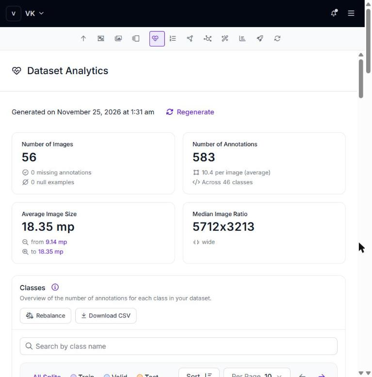
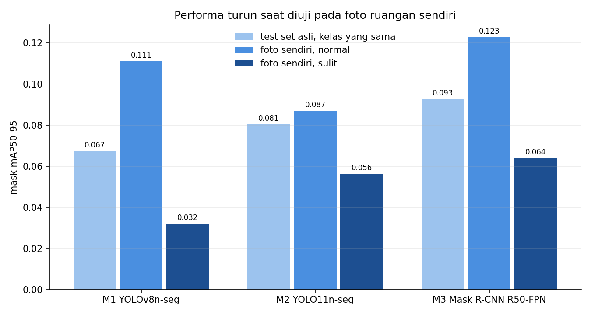
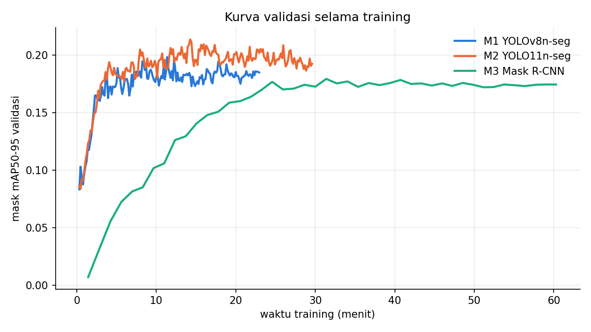
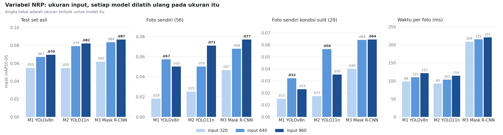
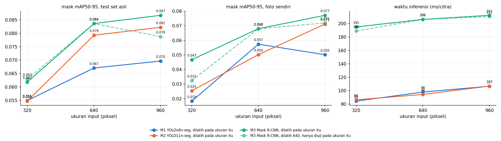

# Progres Week 11: Segmentasi Instance pada Lingkungan Indoor Nyata

Halaman ini merangkum bukti untuk komponen 1 (test set buatan sendiri), komponen 3 (hipotesis), dan hasil perbandingan model yang sudah dilatih. Rincian lengkap ada di [`Hasil_dan_Analisis.md`](Hasil_dan_Analisis.md) dan [`Logbook_CPMK3.md`](Logbook_CPMK3.md).

| Kode | Model | Keluarga |
|---|---|---|
| M1 | YOLOv8n-seg | one-stage, mask dari prototype |
| M2 | YOLO11n-seg | one-stage, mask dari prototype |
| M3 | Mask R-CNN ResNet-50 FPN | two-stage, mask 28×28 per RoI |

## Komponen 1 · Test set buatan sendiri

**56 foto** diambil dengan iPhone 16 pada 24-11-2026, terdiri dari 43 foto kamar kos (16.39–17.08) dan 13 foto laboratorium komputer (20.35–20.37). Dari 56 foto, **29 dalam kondisi sulit**, yaitu 12 redup, 4 oklusi, 4 sudut ekstrem, 3 burem, 2 backlight, dan 4 kombinasi. Foto dianotasi di project Roboflow [`tes-ruangan-sendiri`](https://universe.roboflow.com/vk-a0mta/tes-ruangan-sendiri) dengan nama kelas yang sama dengan dataset latih, menghasilkan 583 objek dari 46 kelas. Pada 25-11-2026 anotasi diperiksa ulang menjadi 555 objek (versi 3, dipakai untuk semua angka di halaman ini), karena 16 boneka yang berlabel `toy` diganti ke `teddy bear` dan potongan kaki kursi serta kaki meja yang tercatat sebagai objek terpisah dihapus.

### Screenshot proses anotasi

| | |
|---|---|
|  |  |
| Halaman dataset, 56 foto beserta label | Ringkasan dataset sebelum pemeriksaan ulang (583 anotasi) |
|  |  |
| Editor anotasi foto kamar kos | Editor anotasi foto laboratorium |

Jumlah objek per kelas ada di [`screenshot_anotasi/5_jumlah_per_kelas.jpg`](screenshot_anotasi/5_jumlah_per_kelas.jpg).

### EXIF / metadata foto

Tabel lengkap untuk 56 foto ada di [`exif_foto_asli.csv`](exif_foto_asli.csv), dan pasangan nama file baru dengan file HEIC aslinya ada di [`daftar_foto_sendiri.csv`](daftar_foto_sendiri.csv).

| File | File asli | Waktu ambil | Kamera | ISO | Eksposur |
|---|---|---|---|---|---|
| `normal_01.jpg` | `IMG_1052.HEIC` | 2026:11:24 16:39:51 | Apple iPhone 16, 5,96 mm f/1.6 | 400 | 1/33 s |
| `sulit_04_redup.jpg` | `IMG_1064.HEIC` | 2026:11:24 16:47:25 | Apple iPhone 16 | 8000 | 1/17 s |
| `sulit_29_redup.jpg` | `IMG_1129.HEIC` | 2026:11:24 20:37:17 | Apple iPhone 16 | 8000 | 1/17 s |

Semua foto berukuran 5712×3213. Median ISO foto redup adalah 2850, sedangkan foto normal 500, sehingga metadata ini sekaligus menjelaskan noise tinggi pada foto redup.

### Performa test set asli vs test set sendiri (mask mAP50-95)

| Model | Test asli | Test asli, kelas foto sendiri | Foto sendiri | Sendiri normal | Sendiri sulit | Penurunan |
|---|---|---|---|---|---|---|
| M1 YOLOv8n-seg | 0,067 | 0,067 | 0,057 | 0,111 | 0,032 | −15% |
| M2 YOLO11n-seg | 0,079 | 0,081 | 0,050 | 0,087 | 0,056 | −38% |
| M3 Mask R-CNN | 0,084 | 0,093 | **0,068** | **0,123** | **0,064** | −27% |

**Analisis domain shift.** Pembanding yang adil adalah test asli yang dibatasi pada kelas yang sama dengan foto sendiri, karena foto sendiri hanya memuat 46 dari 73 kelas. Secara keseluruhan ketiga model turun 15–38%, tetapi penurunannya tidak merata. Foto kos kondisi normal justru lebih tinggi daripada test asli karena objeknya besar dan jelas, sehingga seluruh penurunan datang dari foto sulit dan foto laboratorium. Recall di lab lebih rendah daripada di kos untuk YOLOv8 (0,08 vs 0,10) dan Mask R-CNN (0,10 vs 0,15), sedangkan YOLO11 sama rendahnya di kedua tempat (0,08–0,09). Monitor mati, PC tower, kursi beroda, dan meja panjang lab jarang ada di data latih yang didominasi ruangan rumah. Di antara kondisi sulit, redup dan backlight menurunkan recall paling banyak.

## Komponen 3 · Hipotesis

Hipotesis tertulis di bagian **Hipotesis** pada [`Logbook_CPMK3.md`](Logbook_CPMK3.md), bertanggal **25-11-2026**. Hipotesis ini **ditulis sesudah training** (versi 1 pada 23-11 dan versi 2 pada 24-11), tetapi **sebelum evaluasi test set sendiri** dijalankan (versi 3 pada 25-11). Tanggalnya tidak dimundurkan, dan isinya difokuskan pada eksperimen yang saat itu belum dijalankan.

| No | Hipotesis | Status setelah diuji |
|---|---|---|
| H1 | Mask R-CNN unggul di foto sendiri, terutama objek kecil, karena mask 28×28 dibuat per objek sedangkan prototype YOLO hanya 160×160 untuk seluruh foto | Didukung (AP kecil 0,029 vs 0,006 dan 0,000; oracle 0,99 vs 0,79) |
| H2 | YOLO menyamai Mask R-CNN untuk objek besar | Tidak didukung |
| H3 | Turun > 30%, terbesar di lab | Sebagian |
| H4 | Redup paling merusak | Didukung |
| H5 | Gamma/CLAHE memperbaiki foto redup | Tidak didukung |
| H6 | Salah kelas teddy bear/toy, cabinet/shelf, meja | Sebagian |

Penjelasan untuk hipotesis yang salah ada di bagian 4 [`Hasil_dan_Analisis.md`](Hasil_dan_Analisis.md).

## Hasil perbandingan model pada data latih

Ketiga model dilatih pada Panoptic Indoor Segmentation v5 (397 train, 166 valid, 359 test, 73 kelas setelah typo dibersihkan) di Kaggle GPU Tesla T4, dengan batas 1 jam GPU per model.

| Model | Valid (mask mAP50-95) | Test (mask mAP50-95) | Test mAP50 | Inferensi | Parameter | GPU latih |
|---|---|---|---|---|---|---|
| M1 YOLOv8n-seg | 0,169 | 0,067 | 0,111 | 98 ms | 3,4 juta | 0,39 jam |
| M2 YOLO11n-seg | **0,192** | 0,079 | 0,136 | 94 ms | 2,9 juta | 0,50 jam |
| M3 Mask R-CNN R50-FPN | 0,179 | **0,084** | **0,149** | 206 ms | 44,3 juta | 1,01 jam |

YOLO naik cepat dan berhenti sendiri oleh early stopping (M1 setelah 23 menit, M2 setelah 30 menit), sedangkan Mask R-CNN naik lebih lambat dan memakai seluruh 60 menit. Nilai di split valid dihitung dengan evaluator yang sama dan cocok dengan angka validasi saat training, sehingga test yang lebih rendah berasal dari split test yang lebih sulit.

### Variabel NRP (digit akhir 1): ukuran input 320 / 640 / 960

Ketiga model dilatih ulang pada setiap ukuran lalu diuji pada ukuran yang sama, sehingga ada sembilan model. Batang terang sampai gelap adalah input 320, 640, dan 960, dan angka tebal menandai ukuran terbaik untuk setiap model.

| Model | Set | 320 | 640 | 960 |
|---|---|---|---|---|
| M1 YOLOv8n-seg | Test asli | 0,055 | 0,067 | **0,070** |
| | Foto sendiri | 0,018 | **0,057** | 0,050 |
| | Foto sulit | 0,015 | **0,032** | 0,023 |
| M2 YOLO11n-seg | Test asli | 0,055 | 0,079 | **0,082** |
| | Foto sendiri | 0,025 | 0,050 | **0,071** |
| | Foto sulit | 0,017 | **0,056** | 0,035 |
| M3 Mask R-CNN | Test asli | 0,062 | 0,084 | **0,087** |
| | Foto sendiri | 0,047 | 0,068 | **0,077** |
| | Foto sulit | 0,040 | **0,064** | **0,064** |
| Waktu per foto sendiri | M1 / M2 / M3 | 98 / 93 / 209 ms | 110 / 103 / 215 ms | 122 / 114 / 221 ms |

Input 320 paling buruk untuk ketiga model di semua set, karena foto 5712×3213 yang diperkecil ke 320 membuat objek kecil tinggal beberapa piksel. Di test asli 960 selalu terbaik tetapi hanya +0,003 dari 640, karena citra dataset memang sudah 640. Di foto sendiri 960 terbaik untuk YOLO11 (+42%) dan Mask R-CNN (+13%), karena foto HP punya detail lebih banyak, sedangkan YOLOv8 justru sedikit turun. Di foto sulit 640 terbaik atau sama dengan 960, kemungkinan karena noise ISO tinggi dan blur ikut terlihat jelas di resolusi besar, tetapi foto sulit hanya 29 sehingga ini dibaca sebagai kecenderungan. Setiap naik satu ukuran, waktu inferensi bertambah sekitar 10%.

Kesimpulannya, 960 paling akurat untuk foto HP kondisi normal pada YOLO11 dan Mask R-CNN, 640 paling seimbang dan paling tahan di foto sulit, sedangkan 320 tidak disarankan. Melatih ulang pada ukuran target juga lebih baik daripada hanya mengganti ukuran saat inferensi, karena Mask R-CNN yang dilatih pada 320 mendapat 0,047 di foto sendiri sedangkan model 640 yang hanya diuji pada 320 mendapat 0,032. Grafik garis di bawah memuat perbandingan itu.

## Bukti proses

- Log training asli: [`logs/`](logs) (versi 1 gagal di Mask R-CNN, versi 2 training, versi 3 evaluasi, versi 4 training NRP untuk YOLOv8 dan Mask R-CNN) dan `results.csv` setiap run di [`hasil_kaggle_v4/runs/`](hasil_kaggle_v4/runs)
- Waktu GPU: [`hasil_kaggle_v4/waktu_gpu.json`](hasil_kaggle_v4/waktu_gpu.json), total 6,63 jam training untuk sembilan model
- Logbook: [`Logbook_CPMK3.md`](Logbook_CPMK3.md)
- Deklarasi AI: [`Deklarasi_Penggunaan_AI.md`](Deklarasi_Penggunaan_AI.md)
